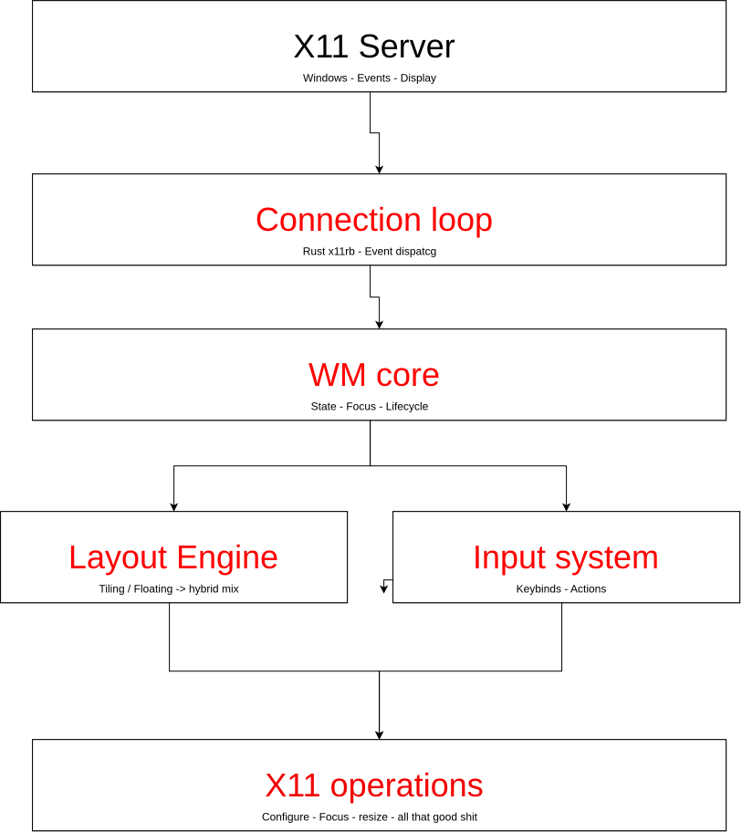
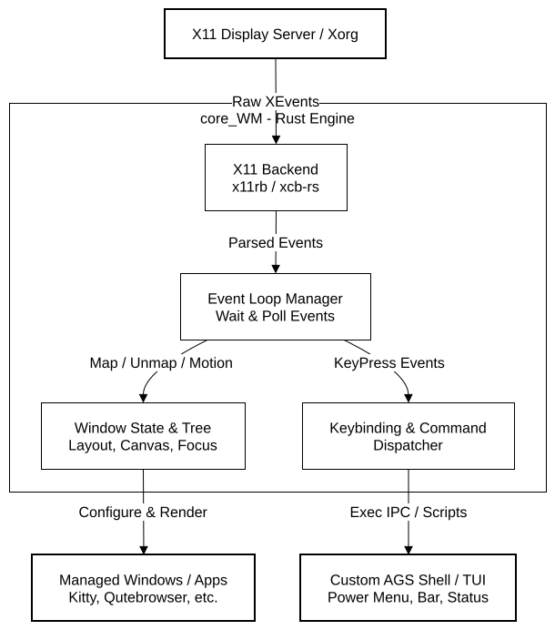
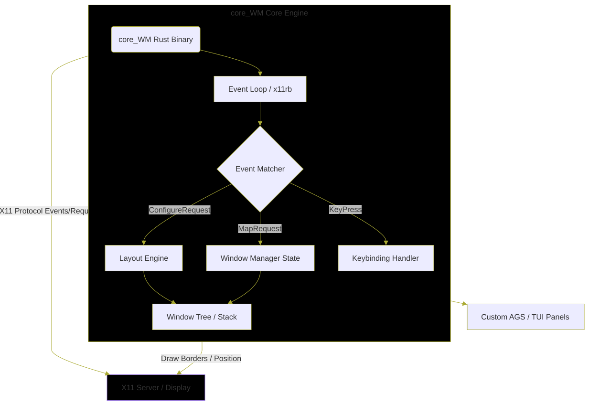
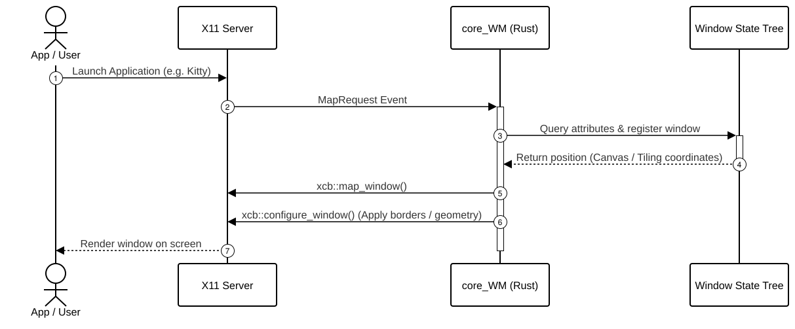
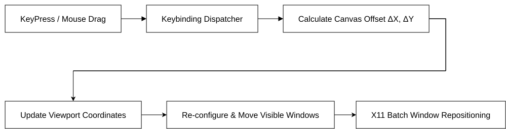

# core_WM

A small, minimalistic yet modern and featurefull X11 window manager, written in Rust.

> **Status: very early.** core_WM is currently at version `0.1.0` — at this point it is
> little more than a window management *handler*: it talks to the X server and reacts to
> a few core events. There is no configuration, no keybinding system, and no decoration
> yet. Expect things to break and the API to change.

## Goals

- **Small.** A tight, readable codebase you can actually hold in your head.
- **Minimalistic.** No bloat, no kitchen-sink feature set for its own sake.
- **Modern.** Written from scratch in Rust, using [x11rb] for a safe, pure-Rust X11 client.
- **Featurefull.** The long-term goal is a genuinely usable WM — see [Roadmap](#roadmap).

## Current features

- Connects to the running X11 display via `DISPLAY`.
- Selects `SubstructureRedirect` / `SubstructureNotify` on the root window.
- Tracks every client window in a `ManagedWindow` struct (id, geometry, floating flag).
- Reacts to `MapRequest` by registering the window, tiling it, and mapping it.
- Reacts to `ConfigureRequest` by forwarding the requested geometry to the X server and
  keeping the struct in sync.
- Reacts to `DestroyNotify` by dropping the window and re-running the layout.
- Arranges managed windows into equal-width vertical columns — the first working tiling
  layout.

## Current Progress

> This is the section I'll keep rewriting as things land — the running log of small steps.
> For the bigger picture, see [Goals](#goals) and [Roadmap](#roadmap).

### Latest: first working tiling layout

core_WM now tiles windows instead of letting them pile up wherever the application happens
to ask for. So far this means:

- **Window bookkeeping.** Every client is stored as a `ManagedWindow` — its X11 id,
  position, size, and a `floating` flag. The struct is updated on `ConfigureRequest` so it
  keeps up with what clients ask for.
- **`arrange_windows()`.** Splits the screen into equal-width columns and hands each
  managed window one column, full height. It's about fifteen lines of arithmetic.
- **Automatic re-layout.** Called on `MapRequest` and `DestroyNotify`, so opening or
  closing a window re-tiles everything and the remaining windows always fill the screen.

### Known limitations

Deliberately minimal for a first cut, but worth knowing:

- **Column order isn't stable.** Windows are iterated out of a `HashMap`, so the
  left-to-right order can shuffle between runs. Needs an ordered container.
- **No gaps or borders.** Windows sit flush against each other.
- **Floating isn't wired up.** The `floating` flag exists but nothing reads it yet.
- **User-driven changes don't stick.** A window that resizes or moves itself keeps that
  geometry until the next map/destroy triggers a re-layout.
- **Closing the last window panics.** `arrange_windows()` divides by the window count
  without guarding the empty case.

> I said I would rework it

## Requirements

- A running X11 server (the project targets X11, not Wayland)
- Rust (edition 2024) — or Nix, if you'd rather not install a toolchain

The only runtime dependency is `x11rb`, which speaks the X11 protocol directly over a
socket. No Xlib, no C bindings.

## Building

With Cargo:

```sh
cargo build --release
```

The binary lands in `target/release/core_wm`.

With Nix (the flake provides a dev shell with `rustc`, `cargo`, `rustfmt`,
`clippy`, `rust-analyzer`, plus `xorgserver`, `xterm`, `xprop` and `xwininfo`
for testing):

```sh
nix develop
```
```sh
cargo build
```

## Running

core_WM takes no arguments. It replaces your current window manager, so be aware
that it is *not* usable as a daily driver yet — you will not be able to move,
resize, or close windows.

```sh
core_wm
```

Since it grabs the root window, launching it will log you out of most desktops.
To try it safely inside a nested X server:

```sh
Xephyr -screen 1280x800 &
DISPLAY=:1 core_wm &
DISPLAY=:1 xterm
```

Any window that misbehaves is still reachable through the raw X tools, for
example `xprop -root _NET_SUPPORTING_WM_CHECK` or `xwininfo -root -tree`.

## Architecture

These are sketches I made in draw.io. They describe where core_WM is *heading* — most of
the boxes below don't exist in the code yet. Editable source for all of them lives in
[core_wm.drawio](docs/diagrams/core_wm.drawio).

### System architecture

The layered view: the X11 server, the connection loop that feeds it events, the WM core
that owns state, and the layout and input systems sitting on top.



### Core system

The same picture with the outside world included — the Xorg server, the panels and shell
that will talk to core_WM, and the applications it ends up managing.



### Core engine

A closer look inside the WM core: the window tree/stack in the middle, and the protocol
events it has to answer (`MapRequest`, `ConfigureRequest`, `KeyPress`).



### New window event flow

What happens when you launch an application — the seven steps from `MapRequest` through to
the window appearing on screen.



### Infinite layout

The direction I want to grow the tiling engine into: an unbounded canvas that pans by
`ΔX`/`ΔY` offsets and only re-configures the windows currently visible in the viewport.



## Roadmap

Completely not in order — this is a wish list, not a commitment:

- [ ] A configuration file and a sane set of defaults
- [ ] Keybindings and mouse bindings (move, resize, focus, close)
- [ ] Focus handling and focus stealing rules
- [ ] Window decorations
- [ ] Tiling and floating layouts — vertical tiling is in, see [Current Progress](#current-progress)
- [ ] Tabs, workspaces / tags, and multi-monitor support
- [ ] IPC (EWMH / ICCCM) so compositors and pagers work correctly

## Contributing

This is a personal project and contributions are not being solicited right now.
Patches, ideas and bug reports are still welcome once the codebase stabilises
a little — see the [issue tracker](https://github.com/germanex3000dev/core_WM/issues).

## License

Released under the [MIT License](LICENSE). Copyright (c) 2026 Germanex3000.

[x11rb]: https://github.com/baskerville/x11rb
